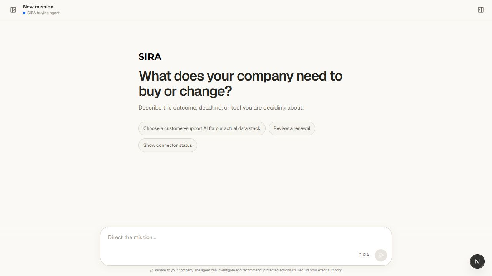
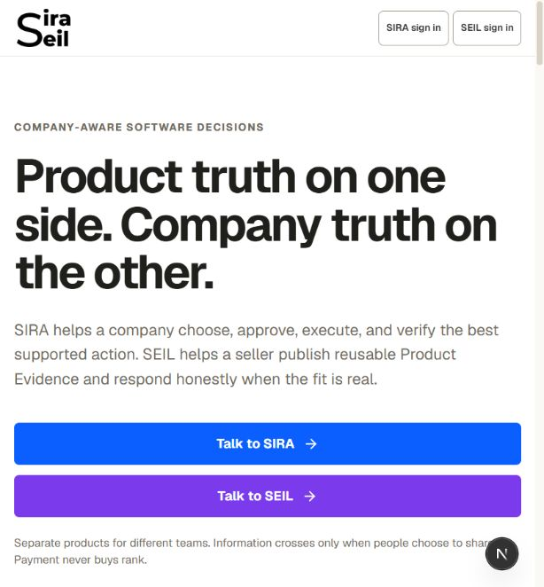
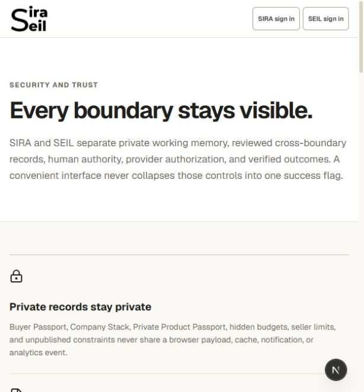
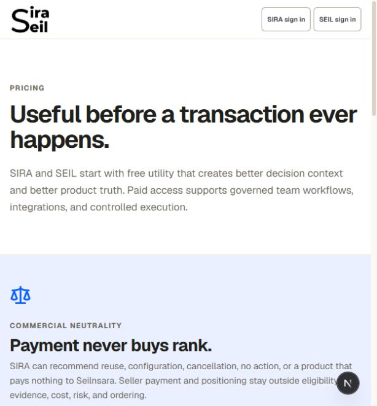
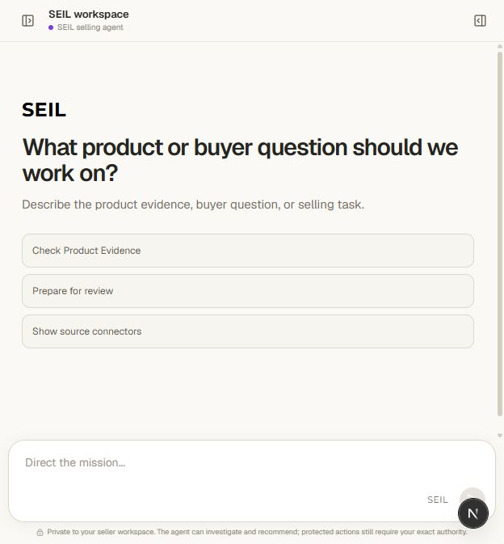
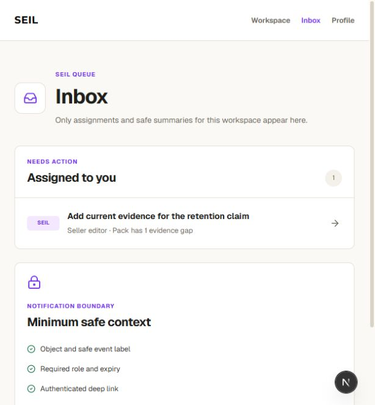
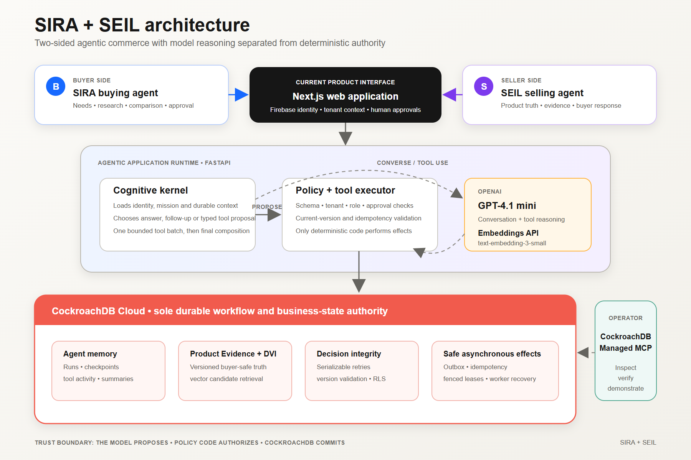

# SIRA + SEIL

**Two company-aware agents for better B2B software decisions.**

SIRA works for the buyer: it investigates a need, compares eligible products, explains the evidence, and asks for approval before protected actions. SEIL works for the seller: it turns product knowledge into reusable, versioned Product Evidence and responds when the fit is real.

CockroachDB is the durable authority that prevents concurrent buyer, seller, and worker activity from producing stale, duplicated, or lost decisions. OpenAI supplies model reasoning and embeddings; LangGraph retries transient model failures, while deterministic application code validates every proposed tool call before it can read or change business state.

## Product tour

| SIRA buying mission | Product overview |
| --- | --- |
|  |  |
| Security and trust | Commercial neutrality |
|  |  |
| SEIL seller workspace | Governed seller inbox |
|  |  |

## How it works



1. The Next.js interface sends an authenticated mission to the FastAPI application.
2. The cognitive kernel gives OpenAI a bounded set of typed tools and relevant CockroachDB-backed context.
3. The model may answer, ask a useful follow-up, or propose tool calls. It cannot execute them directly.
4. Deterministic policy code validates identity, tenant, arguments, approvals, and current versions before executing a proposal.
5. CockroachDB atomically records the run, checkpoints, tool activity, evidence versions, decisions, and outbox effects.
6. The final response is composed from verified tool results and returned in natural language.

CockroachDB is used for more than storage: serializable retries protect concurrent decisions, fenced leases make worker recovery safe, the outbox makes effects idempotent, and Distributed Vector Indexing retrieves candidate evidence without becoming the final eligibility decision. There is no second workflow-state authority.

The runtime uses OpenAI for conversation and embeddings. LangGraph provides bounded transient retries around model calls; CockroachDB persists the authoritative workflow state.

See the [architecture decisions](docs/architecture-decisions.md), [threat model](docs/threat-model.md), and [tool authoring guide](docs/tool-authoring-guide.md).

## Run locally

Requirements: Python 3.12+, [`uv`](https://docs.astral.sh/uv/), Node.js 22+, pnpm 11, Docker Desktop (or WSL2), an OpenAI API key, and a Firebase project with Anonymous Authentication enabled.

```powershell
git clone https://github.com/sandip-pathe/sira-seil-cockroach-aws.git sira-n-seil
cd sira-n-seil
Copy-Item .env.example .env
uv sync --all-extras
corepack pnpm install --frozen-lockfile
```

Fill only the named values in `.env`; never commit credentials. For the functional API-backed experience, set `NEXT_PUBLIC_WEB_DATA_MODE=api`, configure the public Firebase web values, and set `OPENAI_API_KEY`. The example already contains safe loopback CockroachDB URLs for local development.

```powershell
uv run sira-dev doctor --profile local
uv run sira-dev up --profile local
uv run sira-dev status --profile local
```

Open [http://localhost:3000](http://localhost:3000). Choose **SIRA sign in** or **SEIL sign in**, then use the anonymous guest path for an isolated judge session. The API is exposed only on loopback at [http://127.0.0.1:8000](http://127.0.0.1:8000).

Set `OPENAI_API_KEY` in `.env` before starting. `sira-dev up` starts CockroachDB, applies migrations and role grants, and starts the API, Python qualification worker, and web app. The marketplace starts empty; SIRA discovers public products when asked and stores sourced observations for later reuse. The worker polls CockroachDB's durable outbox directly. LangGraph retries transient model errors, while CockroachDB remains responsible for durable checkpoints, leases, and idempotency. Use `uv run sira-dev logs`, `uv run sira-dev check`, and `uv run sira-dev down` for lifecycle operations.

The detailed [setup contract](docs/hackathon-build/SETUP.md), [operations guide](docs/hackathon-build/OPERATIONS.md), and [example environment](.env.example) describe the current local workflow.

## Documentation

- **Product and architecture:** [Persistent marketplace](docs/product-marketplace.md), [architecture decisions](docs/architecture-decisions.md), [current architecture](docs/hackathon-build/architecture.md), and [threat model](docs/threat-model.md).
- **Development and operations:** [setup](docs/hackathon-build/SETUP.md), [configuration](docs/hackathon-build/CONFIGURATION.md), [operations](docs/hackathon-build/OPERATIONS.md), [test plan](docs/hackathon-build/test-plan.md), and [typed tool authoring](docs/tool-authoring-guide.md).
- **UI/UX upgrade:** [design playbook](sira_seil_ui_ux_synthesis_driven_design_system.md), [implementation plan and tracker](sira_seil_ui_ux_implementation_plan.md), [flows and human-control specification](docs/ui-ux-upgrade/flow-and-control-spec.md), [flow blueprints and structural prototype](docs/ui-ux-upgrade/flow-blueprints-and-prototype.md), [design tokens](docs/ui-ux-upgrade/design-tokens.md), [product copy specification](docs/ui-ux-upgrade/copy-spec.md), [claim register](docs/ui-ux-upgrade/claim-register.md), [Step 00 baseline audit](docs/ui-ux-upgrade/route-inventory.md) ([capabilities](docs/ui-ux-upgrade/capability-register.md), [content](docs/ui-ux-upgrade/content-inventory.md), [research evidence](docs/ui-ux-upgrade/research-findings.md), [baseline tasks](docs/ui-ux-upgrade/baseline-tasks.md), [first category](docs/ui-ux-upgrade/first-category-scope.md)), and the [Step 01 business context and authority model](docs/ui-ux-upgrade/business-context-and-authority.md).
- **Project history:** [source provenance](SOURCE_PROVENANCE.md), [historical replication PRD](docs/REPLICATION-PRD.md), and the [Mira UI/UX source playbook](mira_ui_ux_synthesis_driven_design_system.md).

## Verification

```powershell
uv run pytest -q
powershell -ExecutionPolicy Bypass -File scripts/check.ps1
corepack pnpm --dir apps/web build
```

The repository includes unit, contract, security, agent-conversation, and CockroachDB integration coverage. Automated tests use isolated test fixtures; local startup does not seed sample marketplace records.

## Security boundaries

- Buyer context remains buyer-private.
- Seller drafts remain seller-private; only published buyer-safe projections cross into SIRA.
- Public research is labeled and never silently becomes seller-attested evidence.
- Structured eligibility rules decide fit; vector retrieval only finds candidates.
- Purchase and contract actions require explicit human approval.
- The agent never handles card data or claims payment success; an approved purchase can create an immutable external payment handoff.

## Provenance and license

SIRA and SEIL existed before this hackathon. See [SOURCE_PROVENANCE.md](SOURCE_PROVENANCE.md) for the project's source history and provenance.

Licensed under [Apache-2.0](LICENSE).
