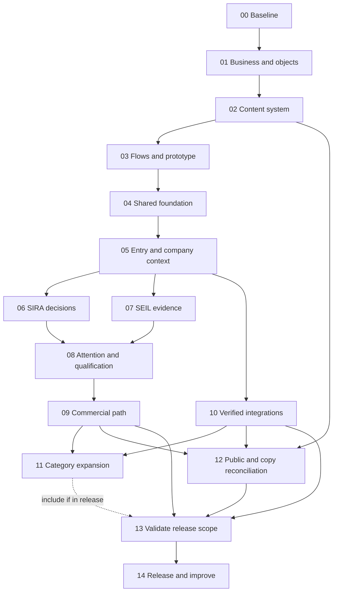

# SIRA + SEIL UI/UX implementation plan

Version 1.0 · 21 October 2026 · Status: in progress; Step 00 audit, Step 01 product model, Step 02 copy draft, Step 03 structural flow blueprints, and Step 04 token/accessibility foundations are underway. Customer comprehension evidence and business-owner decisions remain open dependencies.

This is the execution plan for the [SIRA + SEIL synthesis-driven design playbook](sira_seil_ui_ux_synthesis_driven_design_system.md). It covers public messaging, product copy, navigation, components, buyer and seller workflows, company context, human decisions, integrations, commercial handoffs, validation, and operations.

Companion specifications:

- [Flows, business context, human control, and integrations](docs/ui-ux-upgrade/flow-and-control-spec.md)
- [Marketing and product copy specification](docs/ui-ux-upgrade/copy-spec.md)

The default product direction is **an agent workspace organized around persistent missions and inspectable work**. SIRA represents buyers; SEIL represents sellers. Conversation helps create and revise briefs, evidence, comparisons, and offers. Human judgment and authority enter at specific boundaries. The UI makes outcomes and uncertainty explicit.

## 1. Scope, working assumptions, and execution rules

### What this plan delivers

1. A coherent public-to-product experience for both audiences.
2. A complete supported software-buying journey, including seller evidence and response.
3. Reusable company knowledge, policy context, and role-aware work.
4. Clear delegation, disclosure, publication, introduction, and commercial approval flows.
5. Honest connection and capability states, followed by verified integrations.
6. Category-specific flows for SaaS, APIs, MCPs, skills, internal tools, office suites, and broader procurement as their contracts become available.
7. A maintained content system, reusable components, behavior checks, telemetry, and release evidence.

**Starting assumptions:** use the existing Next.js/React/TypeScript frontend, generated API client, FastAPI services, CockroachDB workflow authority, and established authentication boundaries. Extend the existing visual system. Start with a software purchase category that the current evaluator and exchange actually support; the playbook's meeting-assistant example is a candidate, not a declaration of support. Confirm the category in step 00.

First release uses manual, attributable company context and supported product research without mandatory suite connections. Google Workspace, Microsoft 365, notification channels, runtime tools, and fulfillment actions become available only as their specific integrations are implemented and verified.

### Task and completion rules

- Task IDs such as `06.3` are stable and can become issues or implementation prompts.
- All tasks below are initially unchecked. A written specification is not a completed feature.
- Owner labels describe responsibilities: **Product/research**, **Design**, **Content**, **Frontend**, **Backend**, **Integration**, **QA**, and **Business owner**. One person can perform multiple roles; these labels do not require a larger team or multiple agents.
- Each implementation increment includes copy, permissions, states, accessibility, analytics, and recovery. These are part of the flow rather than a final polish phase.
- Evidence checkpoints are internal verification steps, not repeated permission requests. Continue within authorized scope. Escalate only missing business decisions, unavailable accounts/data, or an action requiring specific authorization.
- Keep existing routes resolvable; propose redirects before moving URLs. Preserve supported functionality and unrelated workspace changes.
- Persist business state on the server. Derive UI actions from real contracts; client visibility and conversational wording do not grant authority.
- Treat public sources, seller documents, and imported instructions as data, not commands to the application.
- When a dependency is missing, deliver the supported preparation/research path and record the dependency. Do not mark the unsupported execution path complete.

### Completion states for tasks

Use `not_started`, `in_progress`, `verified`, or `blocked_dependency` in a working task register. Every `verified` task records code/artifact references and verification evidence. A blocked task records the exact dependency and the independent work still possible. Do not imply a provider integration passed because a UI mock or fixture works.

## 2. Sequence and milestones

| Step | Work package | Depends on | Main owner | Completion milestone |
| --- | --- | --- | --- | --- |
| 00 | Baseline and capability audit | — | Product/research + engineering | Known current journeys and supported capabilities |
| 01 | Business context and decision model | 00 | Product + business owner | Shared jobs, terms, policy boundaries, object model |
| 02 | Messaging and content system | 00–01 | Content + product | Claim-backed copy inventory and first drafts |
| 03 | End-to-end flow and prototype design | 01–02 | Design + product/research | Tested buyer/seller/reviewer prototype |
| 04 | Shared UI and contract foundations | 00–03 | Frontend + backend | Reusable accessible shell and typed presentation boundaries |
| 05 | Entry, company context, roles, and settings | 01, 03–04 | Frontend + backend | Correct workspace with usable manual business context |
| 06 | SIRA mission and decision journey | 03–05 | Frontend + backend | Brief → research → comparison → defensible next step |
| 07 | SEIL product and evidence journey | 03–05 | Frontend + backend | Private draft → review → published evidence |
| 08 | Inbox, human decisions, qualification, introduction | 06–07 | Frontend + backend | Clear attention routing and scoped mutual consent |
| 09 | Offers, approvals, handoff, and recovery | 06–08 | Frontend + backend | Exact supported commercial path with honest outcome |
| 10 | Verified integrations and connected context | 04–05; consumed by 06–09 | Integration + backend | Useful connection capabilities with verified lifecycle |
| 11 | Category lenses and lifecycle expansion | 06–10 | Product + engineering | Category-specific evidence, cost, scope, and actions |
| 12 | Marketing, all-copy reconciliation, and public launch surfaces | 02; reconcile with 05–11 | Content + frontend | Public promises match the available product |
| 13 | Cross-product validation and release readiness | 05–10, 12; 11 for expanded scope | QA + product/research | Critical scenarios and release checks pass |
| 14 | Controlled release and ongoing improvement | 13 | Product + engineering | Observed outcomes, recovery support, iteration queue |

Steps 06 and 07 can progress independently once foundations are stable. Step 10 integration research can begin after 01; its implementation consumes the context and capability contracts from 04–05. Content design continues throughout, with final reconciliation in 12. This dependency model describes scheduling, not a requirement for parallel agents.



**Milestone A:** steps 00–03 produce a concrete, testable experience specification. **Milestone B:** 04–05 establish the usable shell and company context. **Milestone C:** 06–09 complete one buyer–seller journey. **Milestone D:** 10 adds actual connected value. **Milestone E:** 12–14 reconcile, validate, and release the declared scope. Step 11 grows the platform category by category; its unverified capabilities remain outside a release's active promises.

## 3. Detailed work packages

### Step 00 — Establish the current product and baseline

**Purpose:** know which problems are interaction problems, which are missing capabilities, and which are incorrect product promises.

- [x] **00.1 Inventory all routes and entry paths.** Static route ownership, aliases, deep links, and recovery paths are recorded in [route-inventory.md](docs/ui-ux-upgrade/route-inventory.md). Browser verification of every route remains part of Step 13.
- [x] **00.2 Trace one supported journey for each party.** Buyer and seller contracts and authority boundaries are traced in [first-category-scope.md](docs/ui-ux-upgrade/first-category-scope.md) and [capability-register.md](docs/ui-ux-upgrade/capability-register.md); a live user journey was not observed.
- [x] **00.3 Build a capability register.** UI, route/service, durable state, policy, readiness, and environment evidence are recorded in [capability-register.md](docs/ui-ux-upgrade/capability-register.md).
- [x] **00.4 Capture the content baseline.** Surface owners and claim dependencies are recorded in [content-inventory.md](docs/ui-ux-upgrade/content-inventory.md).
- [ ] **00.5 Capture decision episodes and reference mechanisms.** Available product/reference mechanisms and repository-derived friction hypotheses are recorded in [research-findings.md](docs/ui-ux-upgrade/research-findings.md). Customer-workaround episodes remain `blocked_dependency`: no recordings, support data, or interviews were available; do not treat the hypotheses as findings.
- [x] **00.6 Establish baseline tasks and measures.** Tasks, measures, privacy rules, and actual observation counts (zero observed sessions/production events available) are recorded in [baseline-tasks.md](docs/ui-ux-upgrade/baseline-tasks.md). Outcome baselines remain unknown until sessions/data are available.
- [x] **00.7 Choose the first category and release boundary.** Meeting-intelligence SaaS is selected as a source-backed first slice; evaluation, evidence, money, offer/approval, and human handoff limits plus excluded actions are recorded in [first-category-scope.md](docs/ui-ux-upgrade/first-category-scope.md). Commercial owner and cohort validation remain launch dependencies.

**Primary files:** `apps/web/app`, `apps/web/components`, `packages/api-client/src/types.ts`, `services/api/sira_api`, `python/domain`, current architecture/marketplace documents. Historical replication documentation is a reference, not current runtime authority.

**Deliverables:** [route-inventory.md](docs/ui-ux-upgrade/route-inventory.md), [capability-register.md](docs/ui-ux-upgrade/capability-register.md), [content-inventory.md](docs/ui-ux-upgrade/content-inventory.md), [research-findings.md](docs/ui-ux-upgrade/research-findings.md), [baseline-tasks.md](docs/ui-ux-upgrade/baseline-tasks.md), and [first-category-scope.md](docs/ui-ux-upgrade/first-category-scope.md). Research artifacts distinguish observed evidence from repository-derived hypotheses.

**Exit evidence:** every current primary CTA is mapped to a real destination/effect or a documented defect; the first release category has a verified supported action map.

### Step 01 — Establish business context, objects, and authority

**Purpose:** give every flow a clear business job, persistent object, owner, and policy basis.

- [x] **01.1 Define job cards.** Requester, evaluator, approver, policy/IT reviewer, procurement, admin, seller editor/reviewer, and returning-user jobs are recorded in [business-context-and-authority.md](docs/ui-ux-upgrade/business-context-and-authority.md), with modeled roles distinguished from currently enforced roles.
- [x] **01.2 Define positioning and value exchange.** Buyer/seller value, platform role, evidence responsibility, qualification meaning, and no-unapproved-fees default are recorded in [business-context-and-authority.md](docs/ui-ux-upgrade/business-context-and-authority.md). Commercial terms remain an explicit business-owner dependency.
- [x] **01.3 Map persistent objects and links.** Ownership, versions, visibility, status boundaries, authority evidence, and artifact lineage are mapped in [business-context-and-authority.md](docs/ui-ux-upgrade/business-context-and-authority.md).
- [x] **01.4 Define the company-context field catalog.** Current six context kinds are mapped to field families, source/privacy metadata, and validation needs in [business-context-and-authority.md](docs/ui-ux-upgrade/business-context-and-authority.md); no new store is proposed.
- [x] **01.5 Map authority by action.** Edit, publish, release, consent, offer, approval, handoff, connection/tool, and outcome actions are mapped to current server signals and missing capabilities in [business-context-and-authority.md](docs/ui-ux-upgrade/business-context-and-authority.md).
- [x] **01.6 Define information-release policy.** Buyer/seller defaults, allowlisted projection, recipient/purpose, version binding and irreversibility constraints are specified as proposed defaults pending accountable policy approval in [business-context-and-authority.md](docs/ui-ux-upgrade/business-context-and-authority.md).
- [x] **01.7 Record business decisions and defaults.** Open decisions, safe interim defaults, owners and affected product scope are recorded in the decision register in [business-context-and-authority.md](docs/ui-ux-upgrade/business-context-and-authority.md). Unapproved fees, member/approver routing, currency/geography, retention, notifications and launch cohort are not presented as settled business policy.

**Deliverables:** [business decision register, object/action map, field catalog, action/authority matrix, and release-boundary map](docs/ui-ux-upgrade/business-context-and-authority.md), alongside the companion [flow and control document](docs/ui-ux-upgrade/flow-and-control-spec.md).

**Exit evidence:** a business reviewer and engineer can explain what each agent knows, owns, may disclose, and may do. No screen depends on a role or commercial capability that exists only in copy.

### Step 02 — Create the messaging and content system

**Purpose:** make marketing, UI labels, explanations, and agent language describe the same product.

- [x] **02.1 Adopt a shared vocabulary.** The [copy specification](docs/ui-ux-upgrade/copy-spec.md) defines mission, brief, company context, evidence, fit, recommendation, introduction, offer, approval, handoff and outcome, with distinctions from technical authority states.
- [x] **02.2 Establish content models and stable keys.** The copy specification models content IDs, route/state, variables, dependencies, announcements and capability constraints across public, buyer, seller, decision, error, agent and notification surfaces.
- [x] **02.3 Write public positioning and narrative.** The copy specification contains a complete conditional public narrative, CTAs, secondary pages, FAQ, navigation, metadata and footer. It remains a draft until capability and business claims are reconciled.
- [x] **02.4 Write product-state copy.** Draft copy covers entry, permissions, briefs, evidence, seller review, consent, offers, approval, pending/error/unknown states, connection lifecycle, agent responses and notifications. Dynamic authority and delivery remain conditional on server state.
- [x] **02.5 Define agent response structure.** Result, clarification, proposed change, waiting and failure response patterns are specified; fixed state labels remain deterministic.
- [x] **02.6 Create a claim register.** [claim-register.md](docs/ui-ux-upgrade/claim-register.md) maps public/workspace claims to evidence, allowed wording, owner and review trigger. Unsupported integrations, outcomes, fees, ranking guarantees and quantified benefits are withheld.
- [ ] **02.7 Check copy comprehension.** `blocked_dependency`: no representative buyer/seller participants or observed sessions were available. Test protocol and outcome measures are recorded in [baseline-tasks.md](docs/ui-ux-upgrade/baseline-tasks.md); do not call draft copy validated.

**Implementation approach:** use a small typed content module or feature-level content files where repeated content benefits from one source. Avoid a CMS migration or locale framework without a current need. Separate static copy, dynamic facts, and model-generated explanations. Use complete interpolated sentences with locale-aware dates, pluralization, and money formatting.

**Deliverables:** [copy specification](docs/ui-ux-upgrade/copy-spec.md) and [claim register](docs/ui-ux-upgrade/claim-register.md). Code catalog implementation remains in the later UI build steps.

**Exit evidence:** every planned flow has success and failure copy; every consequential action names its effect; no draft claim silently becomes a published fact.

### Step 03 — Design and validate complete flows

**Purpose:** select the interaction structure before expanding application code.

- [x] **03.1 Specify the flow inventory.** F01–F18 are in the [flow and control specification](docs/ui-ux-upgrade/flow-and-control-spec.md); [flow-blueprints-and-prototype.md](docs/ui-ux-upgrade/flow-blueprints-and-prototype.md) connects five critical journeys to concrete backstage work and recovery.
- [x] **03.2 Create service blueprints.** The research-only decision, seller evidence publication, qualified introduction, exact offer/approval/handoff, and future connected-context refresh are mapped in [flow-blueprints-and-prototype.md](docs/ui-ux-upgrade/flow-blueprints-and-prototype.md). Unsupported provider steps are explicitly future dependencies.
- [ ] **03.3 Compare two approaches for key work.** Conversation-led and artifact-led patterns are compared in [flow-blueprints-and-prototype.md](docs/ui-ux-upgrade/flow-blueprints-and-prototype.md). Final selection is `blocked_dependency` on buyer/seller comprehension sessions; artifact-led with optional conversation is the test hypothesis, not a validated result.
- [x] **03.4 Define navigation and route continuity.** Proposed SIRA/SEIL destinations, aliases, return-path rules and deep-link behavior are recorded in [flow-blueprints-and-prototype.md](docs/ui-ux-upgrade/flow-blueprints-and-prototype.md) and [route-inventory.md](docs/ui-ux-upgrade/route-inventory.md). Interaction validation remains for Step 13.
- [x] **03.5 Prototype wide and narrow layouts.** Structural SIRA decision and SEIL evidence-review prototypes are recorded in [flow-blueprints-and-prototype.md](docs/ui-ux-upgrade/flow-blueprints-and-prototype.md). These are layout proposals; visual/interactive prototype validation remains open.
- [ ] **03.6 Run role-based scenario sessions.** `blocked_dependency`: no buyer/seller participants or production scenario data were available. Session tasks are tracked in [baseline-tasks.md](docs/ui-ux-upgrade/baseline-tasks.md); report actual counts only.
- [ ] **03.7 Revise and lock a slice specification.** Keep the first category slice provisional until 03.3/03.6 user evidence and open Step 01 business decisions are reviewed.

**Exit evidence:** representative users can explain the recommendation, its main trade-off, what the agent may do next, what their action changes, and who acts next. Prototype findings and backend correctness remain separate evidence tracks.

### Step 04 — Build shared UI and contract foundations

**Purpose:** give later flows consistent interaction behavior without an unnecessary architecture rewrite.

- [x] **04.1 Consolidate semantic tokens.** Extended existing canvas/surface/ink and party/status colors with semantic spacing, type, radius, elevation, focus, target-size, layer and motion tokens in `apps/web/app/globals.css`; SIRA/SEIL workspace uses shared colors/focus/motion. Sample contrast and remaining audit scope are recorded in [design-tokens.md](docs/ui-ux-upgrade/design-tokens.md). `pnpm check:web`, `pnpm build:web`, and desktop/mobile browser scenarios (16/16) passed; this does not replace component-by-component visual/accessibility review.
- [ ] **04.2 Establish shared primitives** (`in_progress`). The workspace uses 44 px targets for primary navigation, search, prompts, proposal actions, toolbar icon buttons and full-view links. Added a reusable native `ModalDialog` and applied it to seller review submission, with pending-safe Escape handling and focus return. See [interaction-primitives.md](docs/ui-ux-upgrade/interaction-primitives.md). Labeled fields, linked error summaries, shared status/notice patterns and state components remain.
- [ ] **04.3 Build the mission shell.** Organization/party identity, mission heading, privacy, state/version, next action, navigation, artifact canvas, optional conversation, and inspectable detail.
- [ ] **04.4 Establish typed adapters.** Map actual API objects/states/capabilities to display models without inventing authority. Introduce projections only where a flow needs data the existing contract cannot supply; regenerate the client through the repository workflow.
- [ ] **04.5 Standardize asynchronous behavior.** Submission feedback, status reconciliation, draft retention, optimistic concurrency, idempotent retries where supported, cache keys by party/organization/object/version, and explicit stale/unknown states.
- [ ] **04.6 Establish accessibility behavior.** Keyboard order, focus restoration, dialog semantics, status announcements, skip links, noncolor status meaning, reduced motion, and narrow/high-zoom layouts.
- [ ] **04.7 Add instrumentation boundaries.** Separate UI intent, server-confirmed effect, and external outcome. Define a small event envelope without raw private content; start performance baselines.

**Primary files:** `apps/web/app/globals.css`, workspace/component CSS modules, `apps/web/app/providers.tsx`, `apps/web/lib/api.ts`, generated client source contracts. Proposed new shared modules should follow existing project conventions; final extraction boundaries follow actual repeated responsibilities.

**Exit evidence:** a representative mission surface works across wide/narrow widths and keyboard use; states and actions come from typed server data; one mutation demonstrates reconciliation rather than guessed success.

### Step 05 — Implement entry, business context, roles, and settings

**Purpose:** establish the right workspace and useful context with minimal mandatory setup.

- [ ] **05.1 Preserve intent across entry.** Buyer/seller CTA, sign-in, supported guest path, return URL, expired session, and account upgrade lead back to the relevant supported task. Verify whether guest conversion preserves work; do not promise migration unless implemented.
- [ ] **05.2 Clarify workspace identity.** Show organization and party persistently. Validate membership/ownership server-side. Keep buying/selling context separate when switching modes.
- [ ] **05.3 Build progressive manual context capture.** Start with outcome and decision-relevant facts. Support current stack, requirements, policy, and preferences using actual context APIs; mark unknown/inferred/confirmed facts distinctly.
- [ ] **05.4 Build the context record view.** Source, owner, version, confirmed date, freshness, purpose, visibility, correction/retirement, and affected missions. New fields require contract support rather than fabricated values.
- [ ] **05.5 Make policy and authority understandable.** Show applicable spend/access/review rules and next owner. Add supported role-management/routing interfaces only after required backend enforcement exists.
- [ ] **05.6 Implement real settings.** Persist notification/disclosure preferences and concurrency through supported APIs. Show delivery channel readiness separately from saved preferences; quiet hours do not imply email/Slack is operational.
- [ ] **05.7 Verify recovery and isolation.** Refresh, interrupted setup, cross-organization link, wrong party, stale context edit, and revoked membership must preserve allowed work and deny unauthorized access.

**Primary files:** `components/auth`, `components/home/profile-preview.tsx`, `components/home/workspace-account.ts`, workspace routes, `qualification_schemas.py`, qualification/settings services and routes.

**Exit evidence:** a user reaches the intended workspace, creates useful private context, corrects it with a new version, and starts/reopens a mission without a mandatory external connection. An approver role is not granted by changing a profile label.

### Step 06 — Implement the SIRA buying mission

**Purpose:** produce a defensible decision with less repeated work.

- [ ] **06.1 Implement mission entry and resumption.** Outcome-first input, meaningful starter prompts, relevant recent work, goal/state, durable mission lookup, last confirmed work, and next need. Unsupported renewal/deployment prompts must route to explicit research/preparation.
- [ ] **06.2 Implement the editable brief.** Goal, required outcome, must/should/could criteria, company context selections, quantity/usage, timing, commercial assumptions, and private limits. Explain how a change affects evaluation; distinguish mission-level preference from company policy.
- [ ] **06.3 Implement bounded discovery and research.** Show actual source origin, search coverage, research-only status, missing facts, current/stale observations, failures, and supported refresh behavior. Keep private search details out of shared catalog records.
- [ ] **06.4 Implement requirement-led comparison.** Stable selected options, criteria evidence, hard gates, unknown/conflict states, edition/scope, total commitment over a shared horizon, usage assumptions, effort, and keep-current/defer/no-fit paths.
- [ ] **06.5 Implement evidence inspection and next steps.** Open supporting source detail from a criterion. Distinguish “need evidence,” “eliminate,” “keep,” “ask vendor,” and changing a criterion; preserve current feedback/ranking semantics.
- [ ] **06.6 Implement decision version continuity.** Old versions remain inspectable; current actionable version is explicit. New evidence/context invalidation shows a diff and re-evaluation state; selection cannot silently use stale inputs.
- [ ] **06.7 Implement explainable summaries.** Lead with result, supporting evidence, trade-off, unresolved condition, and next owner. Link to decision artifacts rather than repeating an unbounded transcript.
- [ ] **06.8 Verify the complete read/decision slice.** New/return user, missing fact, research provider failure, all options blocked, conflicting sources, changed requirement, stale route, and absent buying authority.

**Primary files:** `components/workspace/commerce-workspace.tsx`, `components/decisions/decision-surfaces.tsx`, `services/api/sira_api/product_marketplace.py`, workspace/decision projection and service code, relevant generated types/contracts.

**Exit evidence:** a requester can create/correct a brief, inspect a comparison, explain why an option is supported or unresolved, and select a valid next step. The same decision can be reopened by URL with its version intact. Commercial execution remains a later, separately authorized boundary.

### Step 07 — Implement the SEIL evidence and publication journey

**Purpose:** let sellers prepare supported product knowledge once, maintain it, and respond accurately.

- [ ] **07.1 Implement product registration and ownership.** Product/edition identity, supported registration/claim workflow, existing-product lookup, ownership/capability status, and draft privacy. Public research is not ownership proof.
- [ ] **07.2 Build the claim/source workbench.** Structured claims, source class, supported upload/link formats, exact supporting spans, observation date, scope, and missing/conflicting evidence. Show real format/size constraints from current contracts.
- [ ] **07.3 Implement fit and anti-fit.** Show where a product is suitable, unsuitable, or needs more information. Keep edition/deployment/region constraints inspectable; avoid model-generated universal-fit claims.
- [ ] **07.4 Implement review preparation and revision diff.** Required gaps, changed claims/sources, reviewer role, exact revision/hash, review submission, changes requested, and stale-review handling.
- [ ] **07.5 Implement publication preview and confirmation.** Show precisely what buyers can see, who publishes, source URL policy, version, and current approval. Publication success comes from the persisted server result.
- [ ] **07.6 Implement evidence lifecycle.** Current versus historical publication, freshness, supersession, suspension/withdrawal where supported, exports, and the effect on active evaluations. Preserve older history and valid published state when a new publication fails.
- [ ] **07.7 Verify seller recovery.** Duplicate source, missing evidence, conflicting claim, invalid format, publication failure, wrong reviewer, edited-under-review, and buyer-safe projection checks.

**Primary files:** `components/seller`, workspace product/evidence panels, seller routes/schemas/service, evidence ingestion/storage code, publication domain and catalog projections.

**Exit evidence:** a seller can create a private revision, resolve gaps, obtain the required exact review, publish a buyer-safe version, and see that version's status. Private drafts and source secrets never appear in the shared catalog.

### Step 08 — Implement human attention, qualification, and introductions

**Purpose:** request human input when it resolves a real dependency, and keep each party's work useful.

- [ ] **08.1 Build the actionable inbox.** Group needs-your-action, waiting-on-others, and material updates. Show mission, reason, owner, consequence, due/expiry, and direct artifact link. Routine progress stays in mission history.
- [ ] **08.2 Implement attention types coherently.** Current `question`, `approval`, `credential`, `choice`, and `blocked` attention prompts each need an appropriate response control, permission check, result state, and recovery. Credential requests route through supported secure connection UI, never ordinary chat secrets.
- [ ] **08.3 Implement exact release previews.** Requirement release and any contact/evidence disclosure show permitted fields, recipient, purpose, version, excluded private content, and receipt. Scope changes invalidate prior review.
- [ ] **08.4 Implement seller qualification response.** Fit / anti-fit / needs-information choices map to real supported commands. Attach evidence or specific missing criteria; avoid exposing private evaluation factors or creating irrelevant sales work.
- [ ] **08.5 Implement separate mutual-consent steps.** Buyer and seller see their own consent scope and current state. Both required valid consents, current decision/evidence dependencies, and appropriate authority precede a qualified introduction.
- [ ] **08.6 Implement introduction receipt and follow-up.** One authoritative introduction/effect, current contact disclosure, next owner, and expiry/revocation semantics. Revocation cannot make previously delivered information unseen.
- [ ] **08.7 Implement supported preference and escalation controls.** In-app priority and settings first; notification delivery only for verified channels. No artificial deadlines or invented reviewer SLA.
- [ ] **08.8 Verify boundary and fatigue scenarios.** Wrong party, refusal, no response, expired consent, changed evidence, repeated click, interrupted response, and returning user. Evaluate interruption count and whether each request was necessary.

**Primary files:** `components/home/inbox-page.tsx`, workspace attention views, qualification services/routes/repositories, introduction/consent logic and generated types.

**Exit evidence:** each party knows what needs them and why, can decline or request information appropriately, and sees only permitted context. A repeated submission produces no duplicate introduction. Consent to contact cannot authorize a purchase or system connection.

### Step 09 — Implement exact commercial terms, approval, and handoff

**Purpose:** turn a supported decision into a clear commercial next step without false completion.

- [ ] **09.1 Build the offer review surface.** Exact product/edition, quantity, unit price, total, currency, commitment, relevant conditions, recipient, expiry, evidence lineage, and authoritative offer version/hash.
- [ ] **09.2 Implement the supported exchange path.** Requirement release → evidence release → buyer offer → seller acceptance or one counteroffer → buyer acceptance of counter → pending approval → approved handoff. Preserve current party ownership and version preconditions.
- [ ] **09.3 Build the term diff.** Show prior/current value, material change, author, time, and downstream approval impact. Stay within the existing one-counteroffer contract until a separately designed extension exists.
- [ ] **09.4 Implement role-specific approval.** Review exact object/scope, amount or access consequence, conditions, current authority, expiry, and authentication requirement. Use reject/revoke/change-request paths only where actual workflow contracts support them; do not infer commands from state enums.
- [ ] **09.5 Implement handoff preparation and destination review.** Recipient, secure destination, amount, reference, approved version, expiration, and known/unknown external state. Use protected server-created destinations rather than arbitrary model-supplied URLs.
- [ ] **09.6 Implement unknown-result and retry recovery.** Refresh/reconcile persisted state after timeout or popup failure; retry the same logical action with supported idempotency semantics. Avoid optimistic commercial-success screens.
- [ ] **09.7 Implement the outcome checkpoint.** Distinguish prepared/opened from externally confirmed purchase, activation, deployment, and adoption. Use a supported self-reported outcome with attribution or an external task when no provider confirmation exists.
- [ ] **09.8 Verify the commercial path.** Changed offer during approval, wrong approver, expired approval/handoff, repeated submission, offline/open failure, unknown external outcome, and returning after handoff.

**Primary files:** `components/exchange/exchange-room.tsx`, decision action/result surfaces, exchange schemas/routes/service/domain compiler, purchase/approval/handoff contracts and persistence.

**Exit evidence:** authorized users can review and execute the supported exact path; unsupported actions stay absent or clearly bounded. UI copy accurately distinguishes agreement, approval, handoff, and fulfillment.

### Step 10 — Implement integrations that add verified business context

**Purpose:** add useful connected capabilities with clear access and truthful readiness.

- [ ] **10.1 Separate integration types.** Authentication identity, company-data connection, product compatibility claim, agent runtime tool, notification delivery, and payment/procurement handoff are different records and capabilities. Signing in with Google does not connect Google Workspace business data.
- [ ] **10.2 Define the shared connection contract.** Provider/account/organization, purpose, granted scope, consenting actor, readiness, supported actions, last successful sync, freshness, error, reconnect/revoke, and data-retention behavior. Define state adapters before adding new enums.
- [ ] **10.3 Implement connection lifecycle and server enforcement.** Purpose/scope preview, provider authorization, callback validation, verified account binding, secure token storage/rotation, bounded data retrieval, partial failure, reconnection, disconnection/revocation, and audit. Confirm provider-specific requirements from official documentation at implementation time.
- [ ] **10.4 Connect one suite for a defined read use case.** Use actual customer demand to choose Google Workspace or Microsoft 365 first. Specify exact resources/fields and minimum supported scope after API feasibility checks; separate user-granted and admin-granted access. Keep manual context usable.
- [ ] **10.5 Convert retrieved facts into attributable context.** Show source/account, sync date, scope, conflicts with manual facts, confirmation, retirement, and effect on active missions. Data access does not imply license/contract/spend visibility.
- [ ] **10.6 Add the second suite through the same proven contract.** Validate feature parity explicitly; unsupported fields remain unavailable instead of guessed.
- [ ] **10.7 Add notifications only after in-app work is reliable.** Select the first delivery channel by user need. Implement identity/destination, preferences, permitted payload, retry/deduplication, quiet hours where relevant, delivery failure, and deep link. Keep channel secrets and private context out of notifications.
- [ ] **10.8 Add runtime/API/MCP capabilities by specific action.** Separate listing/research, installation/connection, authorization, and execution. Pin publisher/version/scope, validate tools, and require supported action-specific control; never trust a tool annotation as an authorization policy.
- [ ] **10.9 Add transaction/procurement integrations only for a defined outcome.** Map provider objects, approvals, external references, events/reconciliation, refunds/cancellations if in scope, and fulfillment truth. Existing external handoff remains the supported default until that work is complete.
- [ ] **10.10 Verify live lifecycle in an appropriate test tenant.** Include wrong account, insufficient admin authority, denied/revoked scope, expired token, provider outage/rate limit, partial sync, duplicate delivery, disconnection, and retained-data policy. Record environment/date and exact verified capabilities.

**References and constraints:** Google documents API-specific authorization scopes in its [Directory API authorization guide](https://developers.google.com/workspace/admin/directory/v1/guides/authorizing). Microsoft Graph distinguishes delegated and application permissions and related consent in its [permissions overview](https://learn.microsoft.com/en-us/graph/permissions-overview). Exact scopes and app verification/consent requirements must follow the selected use case. No list of requested permissions is preapproved by this plan.

**Exit evidence:** each enabled connection can demonstrate its advertised read/action capability and lifecycle. The UI distinguishes account sign-in, connection readiness, permission scope, sync freshness, and individual tool availability. Without external accounts/consent, finish the local contract and tests while leaving live capability unverified.

### Step 11 — Add category-specific buying and lifecycle flows

**Purpose:** broaden the platform without forcing every purchase through a seat-based SaaS comparison.

- [ ] **11.1 Define a category contract per lens.** Required/optional inputs, units, exact money rules, evidence requirements, hard constraints, compatibility, action map, external dependencies, and outcome definition.
- [ ] **11.2 Implement API buying.** Expected/peak usage, billing meter, included limits/overage, expected/high-usage cost, regions, reliability evidence, integration effort, trial/production separation, and supported key/spend controls.
- [ ] **11.3 Implement MCP and skill evaluation.** Intended task, host/runtime, publisher/source, version, data paths, read/write/destructive scope, dependency/update policy, compatibility evidence, and supported install/revoke actions. Tool execution needs its own verification.
- [ ] **11.4 Implement internal-tool/build-versus-buy evaluation.** Existing systems, developer capacity, maintenance owner, integration/access requirements, implementation and exit effort, and supported prototype/deployment actions.
- [ ] **11.5 Implement office-suite evaluation.** Identity/email domain, seats/storage, current tools, overlap, admin responsibility, migration dependencies, adoption effort, total commitment, and a staged cutover preparation path. License purchase, admin grants, and migration remain separate actions.
- [ ] **11.6 Implement renewal, replacement, and consolidation.** Current contract/version, known notice date, usage/seat evidence, alternatives, transition risk, responsible owner, and new approval. Missing contract facts are questions; there is no inferred automatic renewal/cancellation.
- [ ] **11.7 Define broader procurement support.** Goods/services need quantity/specification, availability/location, taxes/shipping, supplier terms, receiving/acceptance, returns/warranty, and fulfillment ownership. Ship research/preparation first; order/invoice/receiving capabilities require dedicated contracts.
- [ ] **11.8 Validate each category independently.** Reuse the shell and controls, but verify category-specific evidence, totals, authority, failure, copy, and outcomes before enabling its end-to-end promise.

**Exit evidence:** a category can explain what it knows, how fit/cost are evaluated, what remains uncertain, and which actions actually work. Product taxonomy alone is not completion of this step.

### Step 12 — Implement marketing and reconcile all customer-facing content

**Purpose:** ensure the public promise, entry flow, working product, and follow-up language match.

- [ ] **12.1 Implement the public narrative.** Hero, buyer/seller paths, how it works, value proof, category coverage, working integration coverage, controls, FAQ, and closing CTA using the copy specification and current capability register.
- [ ] **12.2 Reconcile pricing/commercial language.** Publish only approved business terms and available next steps. Distinguish platform fees from vendor costs; do not imply a working billing/subscription portal or publish invented prices.
- [ ] **12.3 Reconcile trust/security/privacy/terms pages.** Align plain-language summaries with actual boundaries and operating policy. Identify policy/legal decisions that require the appropriate business reviewer; avoid broad promises unsupported by implementation.
- [ ] **12.4 Implement page metadata and shared copy.** Page titles, descriptions, link text, social preview copy/assets, accessible names, footer, contact/support destinations, errors/not-found, and workspace document titles. Verify any new contact or sales form has a working destination.
- [ ] **12.5 Reconcile every in-product state.** Compare content inventory against screens, dialogs, tables, badges, empty/error states, agent templates, connection flows, notifications, and outcomes. Map enums deliberately; avoid raw technical enum rendering in user copy.
- [ ] **12.6 Check claims and permissions.** Remove unsupported logos/testimonials, manufactured proof, promised savings, unavailable integrations, and unsupported completion verbs. Any demonstration data remains explicitly labeled and isolated from production truth.
- [ ] **12.7 Validate comprehension and route integrity.** A buyer and seller should choose the correct entry, understand their agent's value, and reach the promised first useful task. Check all public CTAs and deep links.

**Primary files:** `components/public/landing-page.tsx`, `components/public/public-secondary-pages.tsx`, corresponding CSS modules, `app/layout.tsx`, route metadata, `app/error.tsx`, `app/not-found.tsx`, product feature copy modules and supported notification templates.

**Exit evidence:** every meaningful visible claim has support; every CTA reaches a working destination or explicitly described research/preparation path; marketing does not promise capabilities excluded from the release.

### Step 13 — Validate and prepare the declared release

**Purpose:** establish that the experience works as a system for all relevant roles.

- [ ] **13.1 Run the scenario matrix.** Cover new/return user, manual/connected context, evidence gap/conflict, no-fit, seller review changes, refused/expired consent, wrong role, changed offer, repeat action, and unknown handoff result.
- [ ] **13.2 Run comprehension sessions.** Check result/trade-off, permission/consequence, next owner, and resume behavior. Use small rounds for problem discovery and report counts; do not claim population conversion improvements from them.
- [ ] **13.3 Run focused business correctness checks.** Relevant unit, contract, API, integration, and database checks for exact arithmetic, projection privacy, authority, stale input, idempotency, and durable recovery. Do not add snapshot tests for every string/style.
- [ ] **13.4 Verify accessibility and layout.** Automated accessibility plus keyboard, assistive technology, focus/announcements, reduced motion, long content, high zoom/reflow, and the playbook's wide/narrow targets.
- [ ] **13.5 Verify performance.** Realistic data, long sources/comparisons, slow network, responsive feedback, meaningful background work status, and available field measurements. Separate frontend performance from model/provider/external waiting.
- [ ] **13.6 Verify production boundaries.** Actual auth/organization/party handling, fixture isolation, supported connection states, notification destinations, current policy/configuration, logs, telemetry privacy, and provider failure behavior.
- [ ] **13.7 Prepare release evidence and recovery.** Record scope, changed routes, schema/contract effects, verified environments, integration limits, rollback/recovery options, support ownership, and unresolved issues by severity.
- [ ] **13.8 Check readiness against the eight playbook gates.** A critical authority, data exposure, false-completion, unrecoverable data-loss, or unusable critical-path failure blocks the affected release. Do not average it away with visual scores.

**Existing verification commands:** choose the relevant subset during development; run the required repository checks for the final code release. These are recorded commands, not checks executed by this documentation task.

```powershell
corepack pnpm check:web
corepack pnpm build:web
corepack pnpm test:browser
uv run pytest -q
powershell -ExecutionPolicy Bypass -File scripts/check.ps1
```

`scripts/check.ps1` already runs a broad repository suite, including Python checks and web checks; avoid repeatedly duplicating that entire suite without a change or unresolved concern. Browser checks need the appropriate API/environment, not just a frontend rendering fixtures. Contract changes also require OpenAPI/client regeneration and drift checks through current repository tooling.

**Exit evidence:** the release manifest says exactly what passed, what was not tested, and which capabilities are available. Required checks pass and meaningful failures are resolved.

### Step 14 — Release, observe, and improve

**Purpose:** learn from actual buying and selling outcomes while preserving recovery.

- [ ] **14.1 Release coherent scope.** Use the repository's release workflow and existing authorization. Choose a cohort/feature toggle only if supported; document safe activation and rollback, especially for migrations and durable commercial effects.
- [ ] **14.2 Watch useful outcomes and errors.** First useful artifact, repeated entry, comparison comprehension, qualified response, approval delay, recovery, stale rejection, and unknown external outcomes. Segment by role, category, and connection state.
- [ ] **14.3 Close the outcome loop.** Ask for adoption/result confirmation at relevant moments through supported channels and consent. Attribute self-reported versus provider-confirmed results; make follow-up optional where policy requires it.
- [ ] **14.4 Maintain seller evidence and company context.** Show real freshness/review needs, affected decisions, and owners. Use new versions and re-evaluation rather than silently changing history.
- [ ] **14.5 Maintain content and integration truth.** Recheck claims on capability/policy changes; track provider/API changes, revoked connections, unsupported scopes, delivery failures, and source aging.
- [ ] **14.6 Prioritize the next job from evidence.** Review friction and business outcomes, choose one improvement, rerun the synthesis method, and ship another verified slice. Purchase volume is not a substitute for good decisions or useful seller work.

**Exit evidence:** support can explain and recover active failures, metrics identify the next specific problem, and the backlog links to observed evidence rather than cosmetic preference alone.

## 4. Standard implementation-ticket format

Use this template for each task or coherent sub-slice. It is the minimum handoff from planning to implementation:

```markdown
ID / title:
Status / owner:
User job and trigger:
Business outcome and metric:
Flow IDs / copy IDs:
Dependencies and supported release scope:
Current files, routes, API types, and server policy:
Behavior change and persistent artifacts:
Actor, authority, visibility, and exact effect:
Happy path and empty/loading/partial/stale/blocked/error/uncertain states:
Responsive, keyboard, focus, and announcement behavior:
Analytics and private-data exclusions:
Acceptance scenarios and meaningful checks:
Verification evidence / remaining limitations:
```

If the task cannot name its authoritative object, current contract, or expected effect, resolve that dependency before wiring an action button. Continue any independent content/prototype work.

## 5. First executable increment

Start with tasks **00.1–00.7**, **01.1–01.7**, and **02.1–02.7**, then take **F01–F07** through a supported-category prototype in step 03. The first production implementation increment is steps 04–06 with the minimum seller evidence required to provide a truthful comparison; complete steps 07–09 before declaring the full buyer–seller commercial journey available.

Avoid a separate “copy later” or “permissions later” backlog. Every completed flow includes its actual text, controls, states, authority, business context, and recovery. The companion specifications provide the starting design decisions; audit and prototype evidence determine the final implementation details.
